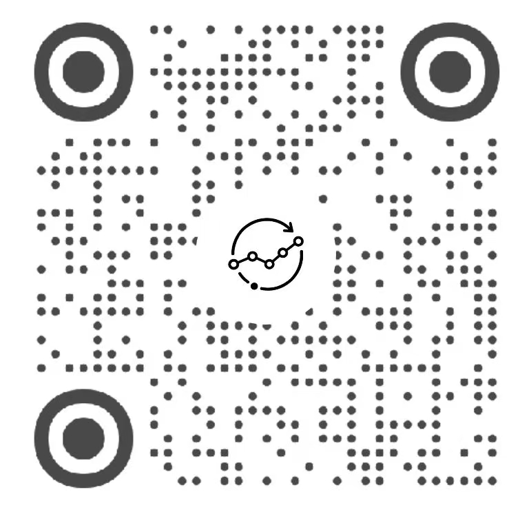

# TraceLite AI

**Open research on AI agent reliability, execution forensics, environments, and post-training.**

---

## Benchmarks & Research

| Project | Venue / Links | Focus |
| :--- | :--- | :--- |
| **[TraceTrial-Bench](https://github.com/TraceLite-AI/TraceTrial-Bench)** | [arXiv:2610.32285](https://arxiv.org/abs/2610.32285) · [Report](https://tracelite.ai/trial-by-trace.html) · [Leaderboard](https://tracelite.ai/leaderboard.html) | 95 mechanism-focused tasks across 7 dimensions (`C`, `E`, `G`, `L`, `O`, `T`, `V`) separating model capability from agent harness reliability |
| **[Judging-by-Evidence](https://github.com/TraceLite-AI/Judging-by-Evidence)** | Research Code | Typed evidence acquisition and verification for Agent-as-a-Judge |
| **[MM-VeriRubric](https://github.com/TraceLite-AI/MM-VeriRubric)** | **EMNLP 2026** | Verifiable evidence-grounded rubrics for multimodal reward models |
| **[DPS](https://github.com/TraceLite-AI/DPS)** | **EMNLP 2026** | Disentangled privileged states for simulator-assisted multi-turn dialogue policy training |
| **[Awesome-Agentic-Environments](https://github.com/TraceLite-AI/Awesome-Agentic-Environments)** | Curated Survey | Papers, benchmarks, and frameworks for building and scaling LLM agent environments |

---

## Upstream Ecosystem Contributions

Using **[TraceTrial-Bench](https://github.com/TraceLite-AI/TraceTrial-Bench#ecosystem-impact)** as a diagnostic probe, we actively contribute bug reports, security fixes, and runtime improvements back to open-source agent frameworks:

- **[OpenHands (`software-agent-sdk`)](https://github.com/OpenHands/software-agent-sdk/pulls?q=is%3Apr+author%3Azsicheng0214)** — 10 pull requests addressing fail-closed sub-agent confirmation & security analyzer inheritance ([#7001](https://github.com/OpenHands/software-agent-sdk/pull/7001), `priority:high`), secret rotation masking ([#7003](https://github.com/OpenHands/software-agent-sdk/pull/7003)), cross-restart sub-agent recovery ([#6986](https://github.com/OpenHands/software-agent-sdk/pull/6986)), MCP tool collision isolation & structured payload preservation ([#6988](https://github.com/OpenHands/software-agent-sdk/pull/6988), [#6989](https://github.com/OpenHands/software-agent-sdk/pull/6989)), sub-agent event streaming ([#6997](https://github.com/OpenHands/software-agent-sdk/pull/6997)), entity-preserving condensation ([#6998](https://github.com/OpenHands/software-agent-sdk/pull/6998)), and deterministic terminal timeout/truncation contracts ([#6987](https://github.com/OpenHands/software-agent-sdk/pull/6987), [#7024](https://github.com/OpenHands/software-agent-sdk/pull/7024), [#7025](https://github.com/OpenHands/software-agent-sdk/pull/7025)).
- **[OpenCode (`anomalyco/opencode`)](https://github.com/anomalyco/opencode/pulls?q=is%3Apr+author%3Azsicheng0214)** — Fixes and proposals for direct MCP structured results ([#64838](https://github.com/anomalyco/opencode/pull/64838)), sub-agent session permission inheritance ([#64841](https://github.com/anomalyco/opencode/pull/64841)), non-interactive `--format json` background event streaming ([#64852](https://github.com/anomalyco/opencode/pull/64852)), and native interactive PTY sessions ([#65017](https://github.com/anomalyco/opencode/issues/65017)).
- **[Aider (`Aider-AI/aider`)](https://github.com/Aider-AI/aider/pull/6002)** — Non-interactive `--yes-shell-commands` execution and shell output reflection ([#6002](https://github.com/Aider-AI/aider/pull/6002), [#6003](https://github.com/Aider-AI/aider/issues/6003)).

---

## Follow Us

<table>
  <tr>
    <td width="50%">
      <strong>Xiaohongshu</strong>
        
      
    </td>
    <td width="50%">
      <strong>WeChat Official Account</strong>
        
      
    </td>
  </tr>
</table>
